# Raw Vault: Lead-Engine

Quelle: `design/implementierungsplan.md`. Kollisionscode je Quelle (`karriere`, `theirstack`, `website`, `freelancer`; freelancer ohne Firma/Link) in allen Hash Keys.

```mermaid
erDiagram
    hub_stelle ||--o{ link_stelle_firma : hk_stelle
    hub_firma ||--o{ link_stelle_firma : hk_firma
    hub_stelle ||--o{ sat_stelle__karriere : hk_stelle
    hub_stelle ||--o{ sat_stelle__theirstack : hk_stelle
    hub_stelle ||--o{ sat_stelle__website : hk_stelle
    hub_stelle ||--o{ sat_stelle_sichtung__karriere : hk_stelle
    hub_stelle ||--o{ sat_stelle_sichtung__theirstack : hk_stelle
    hub_stelle ||--o{ sat_stelle_sichtung__website : hk_stelle
    hub_stelle ||--o{ sat_stelle__freelancer : hk_stelle
    hub_firma ||--o{ sat_firma__firmenprofil : hk_firma
    hub_stelle ||--o{ sat_stelle_sichtung__freelancer : hk_stelle
    hub_firma ||--o{ sat_firma__karriere : hk_firma
    hub_firma ||--o{ sat_firma__theirstack : hk_firma
    hub_firma ||--o{ sat_firma__impressum : hk_firma
    hub_firma ||--o{ sat_firma__firmenbuch : hk_firma
    hub_firma ||--o{ sat_firma__firmenbuch_ereignis : hk_firma
    hub_firma ||--o{ sat_firma__firmenbuch_funktion : "hk_firma (multi-active: funktion_code, pnr)"
    hub_firma ||--o{ sat_firma__jahresabschluss : hk_firma
    hub_gelegenheit ||--o{ sat_gelegenheit__ki_bewertung : hk_gelegenheit
    hub_gelegenheit { char hk_gelegenheit PK
        string collision_code
        string gelegenheit_bk "cluster_key"
        string dss_business_key }
    hub_stelle { char hk_stelle PK
        string collision_code
        string stelle_bk }
    hub_firma { char hk_firma PK
        string collision_code
        string firma_bk }
    link_stelle_firma { char hk_link_stelle_firma PK
        char hk_stelle FK
        char hk_firma FK }
```

Ergänzt 2026-11-03: Firmenbuch (Zuordnung, Veränderungen, Auszug mit Anschrift/Homepage/EUID, Funktionsträger als Multi-Active-Satellit), Jahresabschluss-Kennzahlen und Impressum je Firma; `hub_gelegenheit` (BK = `cluster_key` aus `bv_stelle_cluster`) mit `sat_gelegenheit__ki_bewertung` (historisiert; Eingangstabelle `landing.lead_engine_ki_bewertung`, Quelle der KI-Urteile des Skills lead-bewertung). Weitere Stellen-Satelliten (Adzuna, TED, Details) sind hier nicht einzeln gezeichnet.
